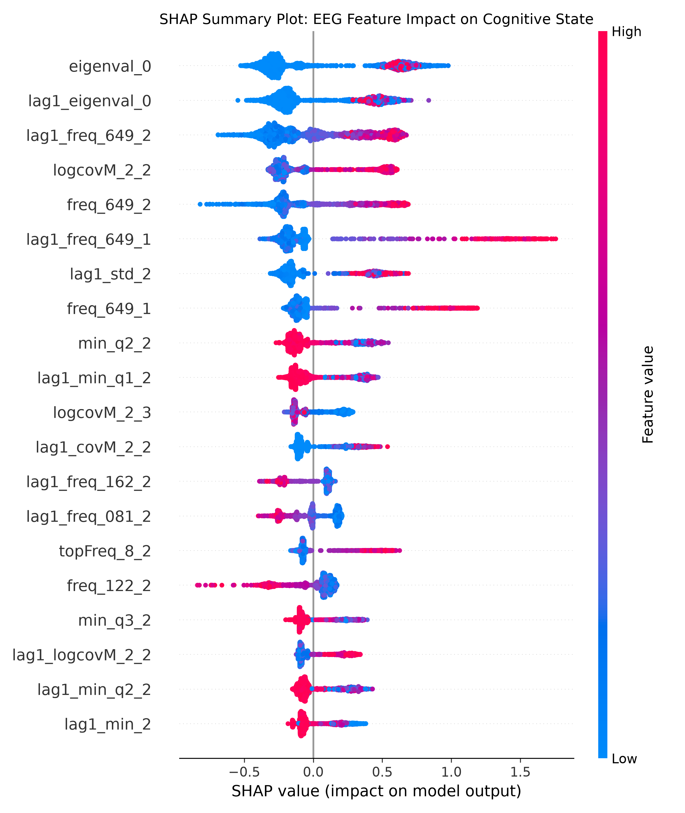

# rbf-double-descent-erm
Empirical demonstration of the Double Descent phenomenon in overparameterized RBF networks, challenging classical Empirical Risk Minimization (ERM) limits using minimum-norm interpolation.

# Beyond Empirical Risk Minimization: Double Descent in Overparameterized RBF Networks

## Overview
Classical statistical learning theory dictates a U-shaped bias-variance tradeoff, suggesting that overparameterized models inevitably overfit. However, modern highly-parameterized models (including neural networks and kernel methods) often exhibit a **"Double Descent"** phenomenon, where generalization performance improves again beyond the interpolation threshold.

This project empirically demonstrates the Double Descent curve using a shallow Radial Basis Function (RBF) network trained on a heavily ill-posed, finite, and noisy dataset. 

## Methodology & Mathematical Formulation
* **Data Generation:** A nonlinear manifold (sine wave) sampled with high Gaussian noise, restricted to a strictly finite regime ($N_{train} = 40$) to simulate an ill-posed Empirical Risk Minimization (ERM) problem.
* **Architecture:** A linear regressor operating on an implicitly mapped RBF feature space.
* **Optimization:** Instead of iterative gradient descent, the system is solved analytically via the **Moore-Penrose Pseudoinverse**. In the overparameterized regime ($N_{params} > N_{train}$), this naturally converges to the minimum-norm solution ($||w||_2 \rightarrow \min$), providing implicit regularization that allows the model to generalize despite perfectly interpolating the noisy training data.

## Results
## Results & Feature Attribution

*The SHAP summary plot illustrates how covariance eigenvalues and specific frequency bands shift the model's log-odds toward the concentrated cognitive state.*

1. **Underparameterized Regime ($N_{params} < N_{train}$):** The model follows classical ERM behavior. Test error decreases as model capacity increases, reaching a minimum before starting to overfit.
2. **Interpolation Threshold ($N_{params} = N_{train}$):** The system has exactly one solution. The model fits the training noise perfectly (Train MSE $\rightarrow 0$), leading to catastrophic variance and a massive spike in Test Error.
3. **Overparameterized Regime ($N_{params} > N_{train}$):** As the number of RBF centers continues to grow, the implicit minimum-norm regularization of the pseudoinverse takes effect. The Test Error undergoes a "second descent," stabilizing at a highly generalizable state despite the extreme model capacity.

## Reproducibility
The experiment is implemented purely in `numpy` to explicitly expose the underlying linear algebra and kernel transformations without relying on deep learning framework abstractions. Run `python double_descent.py` to regenerate the empirical proof.
